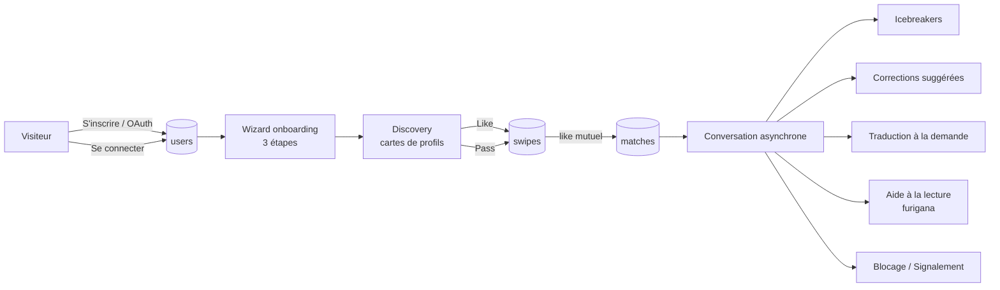
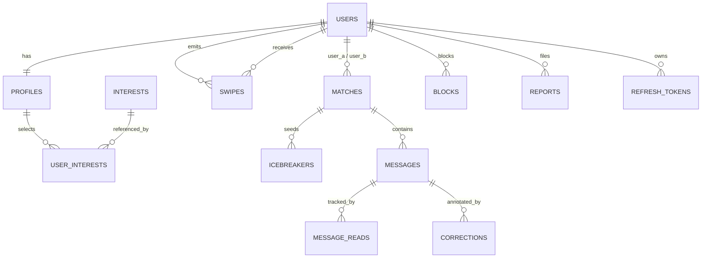
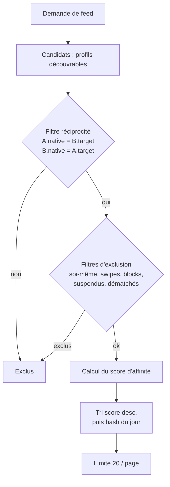

# LangLink — Spécification maître (core)

| | |
|---|---|
| **Projet** | LangLink — plateforme de correspondance linguistique asynchrone |
| **Dépôt** | https://github.com/LapassetAlexis/LangLink |
| **Version de spec** | 0.1.0 (brouillon à valider) |
| **Statut** | `PROPOSÉ` — aucune implémentation autorisée avant validation |
| **Méthode** | Spec-Driven Development (OpenSpec, schéma `spec-driven`) |
| **Propriétaire** | Alexis (Tristabeau) |

> **Note de structure.** Ce fichier est la spec **maître** : il décrit l'intégralité du
> produit en un seul endroit pour la revue humaine. OpenSpec, lui, raisonne par
> **capacités** (`openspec/specs/<capacité>/spec.md`) et par **deltas**
> (`openspec/changes/<change>/specs/<capacité>/spec.md`). La découpe en capacités est
> donnée en §16 ; elle sera matérialisée par le premier change `mvp-v1`, puis fusionnée
> dans `openspec/specs/` à l'archivage. Tant que `mvp-v1` n'est pas archivé, ce fichier
> reste la référence de revue, pas la source de vérité parsée par le CLI.

---

## 0. Résumé et principes

LangLink met en relation deux personnes qui apprennent mutuellement la langue de l'autre,
autour de centres d'intérêt partagés. Le produit est **asynchrone** (on répond quand on
veut, sans pression de présence) et **humain** : aucune génération de texte par IA
n'intervient dans la conversation.

| # | Principe | Conséquence concrète |
|---|---|---|
| P1 | **Réciprocité linguistique stricte** | A (native `fr`, vise `ja`) ne voit que des profils B (native `ja`, vise `fr`). Aucune recommandation asymétrique. |
| P2 | **Zéro IA générative** | Icebreakers = catalogue statique ; traduction = moteur déterministe ; furigana = tokenizer + dictionnaire. Aucun appel LLM dans le chemin produit. |
| P3 | **Consentement mutuel** | Impossible d'écrire à quelqu'un sans `match` (like réciproque). Pas de message non sollicité, pas de demande de contact. |
| P4 | **Progressive disclosure** | L'inscription ne demande que l'essentiel ; le profil se complète par étapes, chaque étape étant sautable sauf les deux premières. |
| P5 | **Asynchrone par défaut** | Aucune fonctionnalité ne dépend d'une présence simultanée. Polling borné, pas de WebSocket en V1. |
| P6 | **Le texte de l'apprenant est sacré** | Une correction est une **suggestion** : l'auteur accepte ou refuse. Personne ne réécrit le message d'un autre. |
| P7 | **Découplage API / Web** | Le backend ne sert que du JSON versionné (`/api/v1`). Aucun template serveur, aucune session cookie hors refresh token. |

### Ce que LangLink n'est pas

- Pas un chatbot, pas un compagnon IA, pas de « conversation avec une IA pour pratiquer ».
- Pas un réseau social de masse : pas de fil public, pas d'abonnés, pas de likes publics.
- Pas un site de rencontre romantique : aucune donnée de genre/orientation, aucun
  algorithme de séduction. (À confirmer, cf. D-09.)
- Pas un correcteur grammatical généraliste : la correction est manuelle, humaine,
  localisée sur un fragment de message.

---

## 1. Glossaire

| Terme | Définition |
|---|---|
| **Langue native** | Langue maternelle déclarée de l'utilisateur (`native_language`, BCP-47). |
| **Langue visée** | Langue que l'utilisateur veut pratiquer (`target_language`, BCP-47). |
| **Niveau** | Niveau déclaré dans la langue visée, échelle CECRL : `A1, A2, B1, B2, C1, C2`. |
| **Paire réciproque** | Couple (A, B) tel que `A.native = B.target` **et** `B.native = A.target`. Seule condition d'affichage dans le discovery. |
| **Profil découvrable** | Profil ayant terminé les étapes 1 et 2 de l'onboarding, actif, non suspendu, non bloqué. |
| **Swipe** | Décision irréversible en V1 : `like` ou `pass` sur un profil. |
| **Match** | Like mutuel matérialisé par une ligne `matches`. Ouvre un fil de discussion. |
| **Icebreaker** | Question brise-glace issue du catalogue statique, sélectionnée à la création du match et persistée. |
| **Correction** | Suggestion localisée (offset + remplacement) portant sur un message reçu, soumise à l'acceptation de l'auteur. |
| **Aide à la lecture** | Annotation déterministe d'un texte (furigana/romaji pour le japonais, pinyin pour le chinois). |
| **Asynchrone** | Aucun état temps réel requis ; le client rafraîchit par polling. |

---

## 2. Acteurs et cas d'utilisation

### 2.1 Acteurs

| Acteur | Description | Authentification |
|---|---|---|
| **Visiteur** | Non authentifié. Peut s'inscrire, se connecter, consulter les CGU. | — |
| **Apprenant** | Utilisateur authentifié, onboarding terminé ou en cours. | JWT |
| **Administrateur** | Rôle `admin`. Consulte les signalements, suspend un compte. | JWT + rôle |

### 2.2 Cas d'utilisation (vue)



### 2.3 Parcours nominal (golden path)

1. Le visiteur s'inscrit par email ou OAuth en moins de 30 secondes (2 champs minimum).
2. Il choisit sa langue native et sa langue visée + niveau (étape 1, obligatoire).
3. Il sélectionne au moins 3 centres d'intérêt dans une grille visuelle (étape 2, obligatoire).
4. Il ajoute facultativement photo + bio (étape 3, sautable) puis arrive sur le discovery.
5. Il like un profil. Plus tard, l'autre personne like en retour → match.
6. À l'ouverture du fil, 3 icebreakers issus de leurs intérêts communs sont proposés.
7. Il écrit, reçoit une correction suggérée, peut la traduire, activer le furigana.
8. Il peut accepter/refuser la correction reçue, bloquer, signaler, se désinscrire.

### 2.4 Exigences transverses du parcours

#### Requirement: [REQ-ONB-01] Onboarding actionnable en moins de 3 minutes
Le système SHALL permettre de terminer l'onboarding obligatoire (étapes 1 et 2) en
moins de 3 minutes et en moins de 8 interactions pointantes.

##### Scenario: Inscription jusqu'au discovery
- **WHEN** un visiteur s'inscrit, choisit `fr` → `ja` (A2) et 3 intérêts
- **THEN** il est redirigé vers le discovery sans étape supplémentaire
- **AND** son profil est découvrable immédiatement

##### Scenario: Reprise après interruption
- **WHEN** un utilisateur ferme le navigateur à l'étape 2
- **AND** se reconnecte plus tard
- **THEN** le wizard reprend à l'étape 2 avec les sélections déjà enregistrées

---

## 3. Modèle de domaine

### 3.1 Entités

| Entité | Rôle | Invariants |
|---|---|---|
| `User` | Identité, credentials, statut | email unique (insensible à la casse) ; un seul provider OAuth actif par compte ; statut ∈ {active, suspended, deleted} |
| `Profile` | Données publiques + préférences linguistiques | 1-1 avec `User` ; `native_language ≠ target_language` ; `target_level` ∈ CECRL ; découvrable ssi étapes 1+2 terminées |
| `Interest` | Référentiel des centres d'intérêt | `slug` unique, immuable ; désactivation sans suppression (intégrité historique) |
| `UserInterest` | Association profil ↔ intérêt | max 12 par utilisateur ; min 3 pour être découvrable |
| `Swipe` | Décision like/pass | unique (swiper, target) ; pas d'auto-swipe |
| `Match` | Like mutuel | paire canonique `user_a_id < user_b_id` ; unique ; statut ∈ {active, unmatched, blocked} |
| `Icebreaker` | Question(s) proposée(s) à la création du match | exactement 3, persistées, immuables |
| `Message` | Message d'un fil | auteur ∈ {membres du match} ; non vide après trim ; ≤ 4000 caractères |
| `MessageRead` | Statut de lecture | unique (message, user) ; jamais pour l'auteur |
| `Correction` | Suggestion de correction localisée | correcteur ≠ auteur du message ; offsets valides sur le corps d'origine |
| `Translation` | Cache de traduction | clé = (hash du texte source, langue cible, provider) |
| `ReadingAid` | Cache d'annotation de lecture | clé = (hash du texte, langue, moteur) |
| `Block` | Blocage unilatéral | unique (blocker, blocked) ; effet immédiat bidirectionnel sur le discovery et le fil |
| `Report` | Signalement | conserve un instantané du contenu signalé |
| `RefreshToken` | Session longue | hash uniquement, révocable |

### 3.2 Relations



### 3.3 Règles métier invariantes

| ID | Règle |
|---|---|
| BR-01 | Un utilisateur ne peut ni se liker, ni se passer, ni matcher avec lui-même. |
| BR-02 | Un match ne peut exister que si deux swipes `like` réciproques existent. |
| BR-03 | Un like n'est jamais notifié à la cible tant qu'il n'est pas réciproque (pas de « qui m'a liké »). |
| BR-04 | Un blocage annule le match (`status = blocked`), ferme l'écriture et masque les deux profils dans les feeds. |
| BR-05 | Un message supprimé est *soft-deleted* : corps remplacé par `"[message supprimé]"`, ligne conservée pour l'intégrité des corrections et des signalements. |
| BR-06 | Un utilisateur ne peut corriger que les messages reçus dans un match actif, et pas les siens. |
| BR-07 | Accepter une correction ne modifie jamais `messages.body` : la version corrigée est calculée à l'affichage (cf. §9.5). |
| BR-08 | Les offsets d'une correction se réfèrent au corps **brut d'origine**, jamais à une version déjà corrigée. |
| BR-09 | Un utilisateur bloqué ne peut plus envoyer de message ni créer de swipe vers le bloqueur (HTTP 403). |
| BR-10 | La suppression de compte est un soft-delete anonymisant sous 30 jours (RGPD), avec purge des photos. |

---

## 4. Schéma de base de données

Cible : **PostgreSQL 16** (dev : SQLite accepté, dialecte compatible via SQLAlchemy 2).
Toutes les dates sont `timestamptz`. Identifiants `uuid` v7 générés applicativement.
Migrations gérées par **Alembic**, une révision par lot livrable.

```sql
-- ============ Identité ============
CREATE TABLE users (
    id                uuid PRIMARY KEY,
    email             citext UNIQUE NOT NULL,
    password_hash     text,                        -- NULL si OAuth-only
    oauth_provider    text,                        -- 'google' | 'github' | NULL
    oauth_subject     text,
    email_verified_at timestamptz,
    role              text NOT NULL DEFAULT 'user' CHECK (role IN ('user','admin')),
    status            text NOT NULL DEFAULT 'active'
                      CHECK (status IN ('active','suspended','deleted')),
    locale            text NOT NULL DEFAULT 'fr',
    created_at        timestamptz NOT NULL DEFAULT now(),
    updated_at        timestamptz NOT NULL DEFAULT now(),
    last_active_at    timestamptz,
    UNIQUE (oauth_provider, oauth_subject),
    CHECK (password_hash IS NOT NULL OR oauth_subject IS NOT NULL)
);

CREATE TABLE profiles (
    user_id              uuid PRIMARY KEY REFERENCES users(id) ON DELETE CASCADE,
    display_name         text NOT NULL CHECK (char_length(display_name) BETWEEN 2 AND 40),
    birth_year           smallint CHECK (birth_year BETWEEN 1900 AND 2100),
    bio                  text CHECK (char_length(bio) <= 600),
    avatar_key           text,                     -- clé de stockage, pas une URL publique
    native_language      text,                     -- BCP-47 : 'fr', 'en', 'ja'...
    target_language      text,
    target_level         text CHECK (target_level IN ('A1','A2','B1','B2','C1','C2')),
    onboarding_step      smallint NOT NULL DEFAULT 1 CHECK (onboarding_step BETWEEN 1 AND 3),
    onboarding_done_at   timestamptz,
    discoverable         boolean NOT NULL DEFAULT false,
    timezone             text NOT NULL DEFAULT 'Europe/Paris',
    updated_at           timestamptz NOT NULL DEFAULT now(),
    CHECK (native_language IS NULL OR target_language IS NULL
           OR native_language <> target_language)
);

CREATE TABLE interests (
    id          smallint PRIMARY KEY,
    slug        text UNIQUE NOT NULL,
    label_fr    text NOT NULL,
    label_en    text NOT NULL,
    emoji       text NOT NULL,
    category    text NOT NULL,                     -- regroupement visuel de la grille
    sort_order  smallint NOT NULL DEFAULT 0,
    active      boolean NOT NULL DEFAULT true
);

CREATE TABLE user_interests (
    user_id     uuid NOT NULL REFERENCES users(id) ON DELETE CASCADE,
    interest_id smallint NOT NULL REFERENCES interests(id),
    created_at  timestamptz NOT NULL DEFAULT now(),
    PRIMARY KEY (user_id, interest_id)
);
CREATE INDEX idx_user_interests_interest ON user_interests(interest_id);

-- ============ Matching ============
CREATE TABLE swipes (
    id         uuid PRIMARY KEY,
    swiper_id  uuid NOT NULL REFERENCES users(id) ON DELETE CASCADE,
    target_id  uuid NOT NULL REFERENCES users(id) ON DELETE CASCADE,
    direction  text NOT NULL CHECK (direction IN ('like','pass')),
    created_at timestamptz NOT NULL DEFAULT now(),
    UNIQUE (swiper_id, target_id),
    CHECK (swiper_id <> target_id)
);
CREATE INDEX idx_swipes_target_like ON swipes(target_id, direction);

CREATE TABLE matches (
    id              uuid PRIMARY KEY,
    user_a_id       uuid NOT NULL REFERENCES users(id) ON DELETE CASCADE,
    user_b_id       uuid NOT NULL REFERENCES users(id) ON DELETE CASCADE,
    status          text NOT NULL DEFAULT 'active'
                    CHECK (status IN ('active','unmatched','blocked')),
    affinity_score  smallint NOT NULL CHECK (affinity_score BETWEEN 0 AND 100),
    created_at      timestamptz NOT NULL DEFAULT now(),
    last_message_at timestamptz,
    UNIQUE (user_a_id, user_b_id),
    CHECK (user_a_id < user_b_id)
);
CREATE INDEX idx_matches_b ON matches(user_b_id);

CREATE TABLE icebreakers (
    id            uuid PRIMARY KEY,
    match_id      uuid NOT NULL REFERENCES matches(id) ON DELETE CASCADE,
    position      smallint NOT NULL CHECK (position BETWEEN 1 AND 3),
    interest_slug text NOT NULL,
    question_fr   text NOT NULL,
    question_en   text NOT NULL,
    UNIQUE (match_id, position)
);

-- ============ Messagerie ============
CREATE TABLE messages (
    id         uuid PRIMARY KEY,
    match_id   uuid NOT NULL REFERENCES matches(id) ON DELETE CASCADE,
    sender_id  uuid NOT NULL REFERENCES users(id) ON DELETE CASCADE,
    body        text NOT NULL CHECK (char_length(body) BETWEEN 1 AND 4000),
    body_lang   text,                              -- langue déclarée, sinon inférée de la langue visée
    client_key  text,                              -- Idempotency-Key du client (anti-doublon d'envoi)
    created_at  timestamptz NOT NULL DEFAULT now(),
    edited_at   timestamptz,
    deleted_at  timestamptz,
    UNIQUE (match_id, sender_id, client_key)
);
CREATE INDEX idx_messages_match_created ON messages(match_id, created_at DESC, id DESC);

CREATE TABLE message_reads (
    message_id uuid NOT NULL REFERENCES messages(id) ON DELETE CASCADE,
    user_id    uuid NOT NULL REFERENCES users(id) ON DELETE CASCADE,
    read_at    timestamptz NOT NULL DEFAULT now(),
    PRIMARY KEY (message_id, user_id)
);

CREATE TABLE corrections (
    id              uuid PRIMARY KEY,
    message_id      uuid NOT NULL REFERENCES messages(id) ON DELETE CASCADE,
    corrector_id    uuid NOT NULL REFERENCES users(id) ON DELETE CASCADE,
    start_offset    integer NOT NULL CHECK (start_offset >= 0),
    end_offset      integer NOT NULL,
    original_text   text NOT NULL,
    replacement     text NOT NULL CHECK (char_length(replacement) BETWEEN 1 AND 4000),
    explanation     text CHECK (char_length(explanation) <= 500),
    status          text NOT NULL DEFAULT 'pending'
                    CHECK (status IN ('pending','accepted','rejected','stale')),
    created_at      timestamptz NOT NULL DEFAULT now(),
    resolved_at     timestamptz,
    CHECK (end_offset > start_offset)
);
CREATE INDEX idx_corrections_message ON corrections(message_id, status);

-- ============ Outils linguistiques (cache) ============
CREATE TABLE translations (
    id          uuid PRIMARY KEY,
    text_hash   text NOT NULL,
    source_lang text NOT NULL,
    target_lang text NOT NULL,
    provider    text NOT NULL,
    translated  text NOT NULL,
    created_at  timestamptz NOT NULL DEFAULT now(),
    UNIQUE (text_hash, source_lang, target_lang, provider)
);

CREATE TABLE reading_aids (
    id         uuid PRIMARY KEY,
    text_hash  text NOT NULL,
    lang       text NOT NULL,
    engine     text NOT NULL,
    payload    jsonb NOT NULL,
    created_at timestamptz NOT NULL DEFAULT now(),
    UNIQUE (text_hash, lang, engine)
);

-- ============ Sécurité / modération ============
CREATE TABLE blocks (
    blocker_id uuid NOT NULL REFERENCES users(id) ON DELETE CASCADE,
    blocked_id uuid NOT NULL REFERENCES users(id) ON DELETE CASCADE,
    reason     text,
    created_at timestamptz NOT NULL DEFAULT now(),
    PRIMARY KEY (blocker_id, blocked_id),
    CHECK (blocker_id <> blocked_id)
);

CREATE TABLE reports (
    id                uuid PRIMARY KEY,
    reporter_id       uuid NOT NULL REFERENCES users(id) ON DELETE CASCADE,
    reported_user_id  uuid NOT NULL REFERENCES users(id) ON DELETE CASCADE,
    message_id        uuid REFERENCES messages(id) ON DELETE SET NULL,
    category          text NOT NULL CHECK (category IN
                      ('spam','harassment','hate','sexual','scam','other')),
    comment           text CHECK (char_length(comment) <= 1000),
    content_snapshot  text,
    status            text NOT NULL DEFAULT 'open'
                      CHECK (status IN ('open','reviewing','actioned','dismissed')),
    created_at        timestamptz NOT NULL DEFAULT now(),
    handled_at        timestamptz,
    handled_by        uuid REFERENCES users(id)
);

CREATE TABLE refresh_tokens (
    id          uuid PRIMARY KEY,
    user_id     uuid NOT NULL REFERENCES users(id) ON DELETE CASCADE,
    token_hash  text NOT NULL UNIQUE,
    expires_at  timestamptz NOT NULL,
    revoked_at  timestamptz,
    user_agent  text,
    ip_hash     text,
    created_at  timestamptz NOT NULL DEFAULT now()
);
CREATE INDEX idx_refresh_user ON refresh_tokens(user_id) WHERE revoked_at IS NULL;
```

### 4.1 Exigences de persistance

#### Requirement: [REQ-PLT-01] Intégrité du schéma
Le système SHALL faire respecter les contraintes d'unicité et de vérification au niveau
base de données, et non uniquement dans la couche applicative.

##### Scenario: Double swipe concurrent
- **WHEN** deux requêtes `POST /discovery/swipes` pour le même couple arrivent en parallèle
- **THEN** une seule insertion réussit
- **AND** l'autre renvoie `409 CONFLICT` avec l'état courant du swipe

##### Scenario: Match dupliqué
- **WHEN** deux likes réciproques déclenchent la création du match simultanément
- **THEN** une seule ligne `matches` est créée (contrainte d'unicité + `ON CONFLICT DO NOTHING`)
- **AND** les deux réponses renvoient le même `match_id`

---

## 5. Contrats API REST

### 5.1 Conventions générales

| Sujet | Règle |
|---|---|
| Base | `/api/v1` |
| Format | JSON UTF-8 uniquement. `Content-Type: application/json`. |
| Auth | `Authorization: Bearer <access_token>` (JWT HS256, 15 min). |
| Refresh | Cookie `HttpOnly; Secure; SameSite=Lax`, chemin `/api/v1/auth`, 30 jours. |
| Identifiants | UUID v7 en chaîne. |
| Dates | ISO 8601 UTC (`2026-10-17T09:12:00Z`). |
| Pagination | Curseur : `?limit=&cursor=` → `{ "items": [...], "next_cursor": "..." \| null }`. |
| Erreurs | RFC 9457 `application/problem+json` : `{type, title, status, detail, instance, errors[]}`. |
| Idempotence | `Idempotency-Key` accepté sur `POST /messages` et `POST /swipes`. |
| Versionnage | Casse majeure = nouveau préfixe `/api/v2`. |
| Rate limiting | Par utilisateur et par IP, en-têtes `RateLimit-*`, `429` + `Retry-After`. |
| Traçabilité | `X-Request-Id` accepté/renvoyé sur toutes les requêtes. |

Codes d'erreur applicatifs stables (champ `type`) :
`auth.invalid_credentials`, `auth.email_taken`, `auth.token_expired`,
`onboarding.incomplete`, `discovery.self_swipe`, `discovery.already_swiped`,
`match.not_found`, `match.not_member`, `match.closed`, `message.too_long`,
`correction.own_message`, `correction.invalid_range`, `correction.conflict`,
`language.unsupported`, `safety.blocked`, `rate.limited`.

### 5.2 Authentification

| Méthode | Chemin | Auth | Description |
|---|---|---|---|
| `POST` | `/auth/register` | — | `{email, password, display_name?, locale?}` → 201 `{user, access_token}` |
| `POST` | `/auth/login` | — | `{email, password}` → 200 `{user, access_token}` + cookie refresh |
| `POST` | `/auth/refresh` | cookie | Rotation du refresh token → 200 `{access_token}` |
| `POST` | `/auth/logout` | JWT | Révoque le refresh courant → 204 |
| `POST` | `/auth/logout-all` | JWT | Révoque toutes les sessions → 204 |
| `GET` | `/auth/me` | JWT | `{user, profile, onboarding}` → 200 |
| `POST` | `/auth/verify-email` | — | `{token}` → 204 |
| `POST` | `/auth/forgot-password` | — | `{email}` → 202 (réponse toujours identique) |
| `POST` | `/auth/reset-password` | — | `{token, new_password}` → 204 |
| `GET` | `/auth/oauth/{provider}/start` | — | 302 vers le provider (`google`, `github`) |
| `GET` | `/auth/oauth/{provider}/callback` | — | 302 front avec cookie refresh |

#### Requirement: [REQ-IDN-01] Inscription par email
Le système SHALL créer un compte actif dès l'inscription, sans exiger la vérification
d'email pour utiliser le produit, tout en marquant `email_verified_at` à NULL.

##### Scenario: Inscription valide
- **WHEN** un visiteur poste un email inconnu et un mot de passe de 12 caractères
- **THEN** l'API renvoie `201` avec un `access_token` valide 15 minutes
- **AND** un profil vide est créé (`onboarding_step = 1`, `discoverable = false`)

##### Scenario: Email déjà utilisé
- **WHEN** l'email existe déjà, quelle que soit la casse
- **THEN** l'API renvoie `409` de type `auth.email_taken`
- **AND** aucun détail sur l'existence d'un compte OAuth n'est divulgué

##### Scenario: Mot de passe faible
- **WHEN** le mot de passe fait moins de 10 caractères ou figure dans la liste des 10 000 plus courants
- **THEN** l'API renvoie `422` avec `errors[{field:"password"}]`

#### Requirement: [REQ-IDN-02] Sessions et rotation des jetons
Le système SHALL émettre un access token court et un refresh token opaque rotatif,
stocké uniquement sous forme de hash.

##### Scenario: Refresh valide
- **WHEN** le client présente un cookie refresh non expiré et non révoqué
- **THEN** l'ancien refresh est révoqué et un nouveau est émis (rotation)
- **AND** un nouvel access token est renvoyé

##### Scenario: Réutilisation d'un refresh révoqué
- **WHEN** un refresh déjà utilisé est présenté
- **THEN** toutes les sessions de l'utilisateur sont révoquées
- **AND** l'API renvoie `401 auth.token_expired`

#### Requirement: [REQ-IDN-03] Connexion OAuth
Le système SHALL supporter Google et GitHub via OAuth 2.0 Authorization Code + PKCE.

##### Scenario: Premier login OAuth
- **WHEN** un utilisateur revient du provider avec un email inconnu
- **THEN** un compte est créé avec `email_verified_at` renseigné
- **AND** `onboarding_step = 1`

##### Scenario: Rapprochement de compte
- **WHEN** l'email OAuth correspond à un compte email/mot de passe existant
- **THEN** le provider est rattaché au compte existant sans écraser le mot de passe
- **AND** l'utilisateur est connecté

### 5.3 Onboarding et profil

| Méthode | Chemin | Auth | Description |
|---|---|---|---|
| `GET` | `/onboarding/state` | JWT | Étape courante, données enregistrées, champs manquants |
| `PUT` | `/onboarding/languages` | JWT | `{native_language, target_language, target_level}` → 200 |
| `PUT` | `/onboarding/interests` | JWT | `{interest_ids: [..]}` (3 à 12) → 200 |
| `PUT` | `/onboarding/profile` | JWT | multipart `{display_name, bio?, avatar?}` → 200 |
| `POST` | `/onboarding/complete` | JWT | Valide les prérequis, `discoverable = true` → 200 |
| `GET` | `/interests` | — | Catalogue groupé par catégorie → 200 |
| `GET` | `/me/profile` | JWT | Profil complet + intérêts → 200 |
| `PATCH` | `/me/profile` | JWT | Mise à jour partielle (hors langues) → 200 |
| `PUT` | `/me/languages` | JWT | Changement de paire linguistique → 200 |
| `PUT` | `/me/interests` | JWT | Remplacement de la sélection → 200 |
| `DELETE` | `/me` | JWT | Suppression de compte (confirmation par mot de passe) → 204 |
| `PUT` | `/me/availability` | JWT | `{discoverable: bool}` → 200 |

#### Requirement: [REQ-ONB-02] Validation de l'étape 1
Le système SHALL refuser une paire linguistique où la langue native égale la langue visée,
et exiger un niveau CECRL valide.

##### Scenario: Langues identiques
- **WHEN** l'utilisateur envoie `{native_language:"fr", target_language:"fr"}`
- **THEN** l'API renvoie `422` avec `errors[{field:"target_language", code:"same_as_native"}]`

##### Scenario: Langue non supportée
- **WHEN** `target_language` n'appartient pas au référentiel des langues actives
- **THEN** l'API renvoie `422 language.unsupported`

#### Requirement: [REQ-ONB-03] Seuil d'intérêts
Le système SHALL exiger au moins 3 centres d'intérêt et en accepter au plus 12.

##### Scenario: Deux intérêts seulement
- **WHEN** l'utilisateur soumet 2 intérêts
- **THEN** l'API renvoie `422` avec `errors[{field:"interest_ids", code:"min_3"}]`
- **AND** l'étape reste non validée

##### Scenario: Intérêt inconnu ou inactif
- **WHEN** la liste contient un identifiant absent du référentiel actif
- **THEN** l'API renvoie `422` et n'enregistre aucune sélection (transaction atomique)

#### Requirement: [REQ-ONB-04] Finalisation de l'onboarding
Le système SHALL rendre le profil découvrable uniquement si les étapes 1 et 2 sont
complètes et que le profil n'est ni suspendu ni bloqué.

##### Scenario: Finalisation incomplète
- **WHEN** `POST /onboarding/complete` est appelé sans intérêts
- **THEN** l'API renvoie `409 onboarding.incomplete` avec la liste des prérequis manquants
- **AND** `discoverable` reste `false`

### 5.4 Découverte et matching

| Méthode | Chemin | Auth | Description |
|---|---|---|---|
| `GET` | `/discovery/feed?limit=20` | JWT | Profils compatibles non encore swipés, triés par affinité |
| `POST` | `/discovery/swipes` | JWT | `{target_id, direction, idempotency_key?}` → 201 `{match?}` |
| `GET` | `/discovery/swipes/{target_id}` | JWT | État du swipe courant (pour restaurer l'UI) |
| `DELETE` | `/discovery/swipes/{target_id}` | JWT | Annulation du dernier swipe (`rewind`, max 1/heure) |
| `GET` | `/matches` | JWT | Liste des matchs actifs avec dernier message + non-lus |
| `GET` | `/matches/{id}` | JWT | Détail du match, icebreakers, score, profil public |
| `DELETE` | `/matches/{id}` | JWT | Dématch unilatéral (`status = unmatched`) → 204 |

#### Requirement: [REQ-DSC-01] Réciprocité stricte du feed
Le système SHALL n'exposer que les profils dont la paire linguistique est réciproque
avec celle du demandeur.

##### Scenario: Candidat non réciproque
- **WHEN** A est `fr→ja` et B est `ja→es`
- **THEN** B n'apparaît jamais dans le feed de A
- **AND** aucune entrée de cache ne contient B pour A

##### Scenario: Paires réciproques multiples
- **WHEN** A est `fr→ja` et B est `ja→fr`
- **THEN** B est éligible pour A et A est éligible pour B

#### Requirement: [REQ-MAT-01] Score d'affinité explicable
Le système SHALL calculer un score entier 0–100 à partir des intérêts communs et de la
proximité de niveau, et l'exposer pour rendre le classement compréhensible.

Formule normative :
```
overlap    = |Ia ∩ Ib| / min(|Ia|, |Ib|)          # couverture du plus petit profil
jaccard    = |Ia ∩ Ib| / |Ia ∪ Ib|                # similarité globale
level_fit  = 1 - |niveau(A) - niveau(B)| / 5      # A1=1 … C2=6
score      = round(100 * (0.5*overlap + 0.3*jaccard + 0.2*level_fit))
```

##### Scenario: Trois intérêts communs sur cinq
- **WHEN** A a 5 intérêts, B en a 5, dont 3 communs, et tous deux sont B1
- **THEN** `overlap = 0.6`, `jaccard = 0.4286`, `level_fit = 1`
- **AND** le score renvoyé vaut `63`  (100 × (0.5×0.6 + 0.3×0.4286 + 0.2×1) = 62.86 → 63)

##### Scenario: Aucun intérêt commun
- **WHEN** l'intersection est vide
- **THEN** le score vaut au plus `20` (seul `level_fit` contribue)
- **AND** le candidat est relégué après tous ceux ayant au moins un intérêt commun

#### Requirement: [REQ-DSC-02] Exclusions du feed
Le système SHALL exclure du feed : soi-même, les profils déjà swipés, les profils
bloqués dans un sens ou l'autre, les comptes non découvrables ou suspendus.

##### Scenario: Profil déjà passé
- **WHEN** A a déjà `pass` sur B
- **THEN** B n'est plus proposé à A, même après redémarrage du client

##### Scenario: Blocage croisé
- **WHEN** B a bloqué A
- **THEN** A ne voit plus B dans son feed
- **AND** toute tentative de swipe de A vers B renvoie `403 safety.blocked`

#### Requirement: [REQ-MAT-02] Création du match sur like mutuel
Le système SHALL créer un match atomiquement lors du second like et générer dans la même
transaction les 3 icebreakers.

##### Scenario: Like réciproque
- **WHEN** A like B alors que B avait déjà liké A
- **THEN** la réponse `201` contient `match` avec `affinity_score`
- **AND** 3 icebreakers sont persistés et renvoyés
- **AND** le match apparaît dans `GET /matches` des deux utilisateurs

##### Scenario: Like non réciproque
- **WHEN** A like B et B n'a encore rien décidé
- **THEN** la réponse `201` a `match: null`
- **AND** B ne reçoit aucune notification de type « quelqu'un t'a liké »

#### Requirement: [REQ-MAT-03] Dématch
Le système SHALL permettre à un membre de fermer définitivement un match.

##### Scenario: Dématch unilatéral
- **WHEN** A appelle `DELETE /matches/{id}`
- **THEN** `status = unmatched` et le fil devient accessible en lecture seule
- **AND** l'envoi de message renvoie `409 match.closed`
- **AND** les swipes restent en base : aucun nouveau match ne peut se former

### 5.5 Messagerie

| Méthode | Chemin | Auth | Description |
|---|---|---|---|
| `GET` | `/matches/{id}/messages?limit=30&before=` | JWT | Page de messages (ordre antéchronologique) |
| `POST` | `/matches/{id}/messages` | JWT | `{body, body_lang?}` → 201 message |
| `POST` | `/matches/{id}/read` | JWT | `{last_message_id}` → 200 `{unread_count:0}` |
| `PATCH` | `/messages/{id}` | JWT | Édition par l'auteur, ≤ 15 min, marque `edited_at` |
| `DELETE` | `/messages/{id}` | JWT | Soft-delete par l'auteur → 204 |
| `GET` | `/matches/{id}/unread-count` | JWT | Compteur léger pour le polling |

#### Requirement: [REQ-MSG-01] Accès restreint au fil
Le système SHALL refuser tout accès à un fil par un non-membre.

##### Scenario: Intrusion
- **WHEN** C appelle `GET /matches/{id}/messages` d'un match A–B
- **THEN** l'API renvoie `404 match.not_found` (pas `403`, pour ne pas révéler l'existence)

#### Requirement: [REQ-MSG-02] Envoi de message
Le système SHALL valider la longueur (1–4000 après trim), l'appartenance au match actif et
le non-blocage, puis mettre à jour `matches.last_message_at`.

##### Scenario: Message valide
- **WHEN** A envoie `"Bonjour !"` dans un match actif
- **THEN** le message est créé avec `body_lang` = langue visée de A
- **AND** `last_message_at` du match est mis à jour
- **AND** B voit `unread_count` incrémenté au prochain polling

##### Scenario: Message vide ou trop long
- **WHEN** le corps ne contient que des espaces, ou dépasse 4000 caractères
- **THEN** l'API renvoie `422` et n'écrit rien

##### Scenario: Match fermé
- **WHEN** A tente d'écrire après un dématch ou un blocage
- **THEN** l'API renvoie `409 match.closed`

#### Requirement: [REQ-MSG-03] Statut de lecture
Le système SHALL enregistrer la lecture par message et exposer un compteur de non-lus.

##### Scenario: Marquage en lot
- **WHEN** B ouvre le fil et appelle `POST /read` avec `last_message_id`
- **THEN** toutes les lignes non lues jusqu'à cet identifiant sont marquées
- **AND** le compteur de B retombe à 0

##### Scenario: L'auteur ne compte pas
- **WHEN** A envoie un message
- **THEN** aucun `message_reads` n'est créé pour A
- **AND** ce message n'entre jamais dans le compteur de non-lus de A

### 5.6 Corrections collaboratives

| Méthode | Chemin | Auth | Description |
|---|---|---|---|
| `POST` | `/messages/{id}/corrections` | JWT | `{start_offset, end_offset, replacement, explanation?}` → 201 |
| `GET` | `/messages/{id}/corrections` | JWT | Corrections visibles selon le rôle (auteur vs correcteur) |
| `POST` | `/corrections/{id}/accept` | JWT (auteur) | Accepte → 200 |
| `POST` | `/corrections/{id}/reject` | JWT (auteur) | Refuse → 200 |
| `DELETE` | `/corrections/{id}` | JWT (correcteur) | Retire une suggestion encore `pending` → 204 |

#### Requirement: [REQ-COR-01] Suggestion localisée
Le système SHALL valider que la plage `[start_offset, end_offset)` est incluse dans le
corps du message et que `original_text` correspond exactement au fragment ciblé.

##### Scenario: Plage invalide
- **WHEN** `end_offset` dépasse la longueur du corps
- **THEN** l'API renvoie `422 correction.invalid_range`
- **AND** aucune correction n'est créée

##### Scenario: Auto-correction interdite
- **WHEN** l'auteur d'un message tente de le corriger lui-même
- **THEN** l'API renvoie `422 correction.own_message`

##### Scenario: Chevauchement de suggestions
- **WHEN** une suggestion `pending` chevauche déjà la plage demandée
- **THEN** l'API renvoie `409 correction.conflict` avec l'identifiant de la suggestion existante

#### Requirement: [REQ-COR-02] Décision de l'auteur
Le système SHALL réserver l'acceptation et le refus à l'auteur du message, et rendre la
décision définitive.

##### Scenario: Acceptation
- **WHEN** l'auteur accepte une correction `pending`
- **THEN** `status = accepted`, `resolved_at` est renseigné
- **AND** le message affiché contient le fragment remplacé (calcul à la volée)
- **AND** `messages.body` reste inchangé en base

##### Scenario: Correction devenue obsolète
- **WHEN** l'auteur édite le message et que les offsets ne correspondent plus
- **THEN** la correction passe automatiquement à `stale`
- **AND** elle n'est plus proposée à l'acceptation

##### Scenario: Décision par un tiers
- **WHEN** le correcteur tente d'accepter sa propre suggestion
- **THEN** l'API renvoie `403` et le statut reste `pending`

### 5.7 Outils linguistiques

| Méthode | Chemin | Auth | Description |
|---|---|---|---|
| `POST` | `/language/translate` | JWT | `{message_id}` ou `{text, source_lang, target_lang}` → 200 |
| `POST` | `/language/reading-aid` | JWT | `{message_id}` ou `{text, lang}` → 200 |
| `GET` | `/language/capabilities` | JWT | Langues traduisibles + langues avec aide à la lecture |

#### Requirement: [REQ-LNG-01] Traduction à la demande
Le système SHALL ne traduire qu'à la demande explicite, mettre en cache le résultat et ne
jamais envoyer de trafic utilisateur à un service tiers sans action de l'utilisateur.

##### Scenario: Traduction d'un message
- **WHEN** B demande la traduction d'un message de A (`fr` → `ja`)
- **THEN** l'API renvoie `{translated, provider, cached:false}`
- **AND** une seconde demande identique renvoie `cached:true` sans appel externe

##### Scenario: Provider indisponible
- **WHEN** LibreTranslate ne répond pas dans les 5 secondes
- **THEN** l'API bascule sur le provider secondaire configuré
- **AND** si les deux échouent, renvoie `503 language.provider_unavailable`
- **AND** aucune erreur 500 n'est exposée à l'utilisateur

##### Scenario: Langue non supportée
- **WHEN** la paire demandée n'est pas dans `capabilities`
- **THEN** l'API renvoie `422 language.unsupported` et l'UI masque l'action

#### Requirement: [REQ-LNG-02] Aide à la lecture déterministe
Le système SHALL produire, pour le japonais, une annotation tokenisée `{surface, reading,
romaji, start, end}` via un tokenizer et un dictionnaire locaux, sans appel réseau.

##### Scenario: Phrase japonaise
- **WHEN** l'utilisateur demande l'aide à la lecture pour `"私は学生です"`
- **THEN** la réponse contient 4 à 6 tokens avec `reading` en kana et `romaji`
- **AND** les offsets reconstituent exactement le texte d'origine

##### Scenario: Langue sans aide disponible
- **WHEN** la langue demandée n'a pas de moteur configuré
- **THEN** l'API renvoie `422 language.unsupported`
- **AND** le bouton n'est pas rendu côté client

### 5.8 Sécurité et modération

| Méthode | Chemin | Auth | Description |
|---|---|---|---|
| `POST` | `/users/{id}/block` | JWT | Bloque → 204 |
| `DELETE` | `/users/{id}/block` | JWT | Débloque → 204 |
| `GET` | `/me/blocks` | JWT | Liste des profils bloqués |
| `POST` | `/reports` | JWT | `{reported_user_id, message_id?, category, comment?}` → 201 |
| `PATCH` | `/admin/reports/{id}` | admin | `{status, action?}` → 200 |
| `POST` | `/admin/users/{id}/suspend` | admin | Suspend → 204 |

#### Requirement: [REQ-SAF-01] Effet immédiat du blocage
Le système SHALL appliquer le blocage sans délai au feed, au fil et à l'envoi.

##### Scenario: Blocage pendant une conversation
- **WHEN** A bloque B alors qu'ils ont un match actif
- **THEN** le match passe à `blocked`
- **AND** B ne peut plus écrire (`403 safety.blocked`)
- **AND** B ne voit plus le profil de A dans son feed

#### Requirement: [REQ-SAF-02] Signalement conservant la preuve
Le système SHALL enregistrer un instantané du contenu signalé au moment du signalement.

##### Scenario: Signalement d'un message
- **WHEN** B signale un message de A avec la catégorie `harassment`
- **THEN** un `report` est créé avec `content_snapshot` = corps du message à cet instant
- **AND** le message reste visible pour les membres du fil

---

## 6. Stratégie d'enrôlement

### 6.1 Principe : friction minimale, complétion progressive

| Étape | Obligatoire | Champs | Bloquant pour le discovery |
|---|---|---|---|
| 0. Compte | Oui | email, mot de passe **ou** OAuth | Oui |
| 1. Langues | Oui | native, target, niveau | Oui |
| 2. Intérêts | Oui | 3 à 12 parmi 60 | Oui |
| 3. Profil | Non | nom affiché, bio, photo | Non |

- Le nom affiché est dérivé de l'email (partie locale) s'il n'est pas fourni, puis
  modifiable à l'étape 3.
- Chaque étape est persistée immédiatement (`PUT` séparé) : aucune perte en cas de
  fermeture d'onglet.
- `discoverable` n'est mis à `true` qu'à la fin de l'étape 2 (ou à la fin de l'étape 3 si
  l'utilisateur la complète).
- Aucune vérification d'email bloquante en V1 ; relance douce après 72 h.

### 6.2 Exigences d'enrôlement

#### Requirement: [REQ-ONB-05] Barre de progression fiable
Le système SHALL afficher une progression à 3 segments reflétant l'étape courante, et
permettre le retour arrière sans perte de données.

##### Scenario: Retour à l'étape précédente
- **WHEN** l'utilisateur revient de l'étape 3 à l'étape 2
- **THEN** ses intérêts restent cochés
- **AND** la barre affiche 2/3

#### Requirement: [REQ-ONB-06] Étape 3 sautable
Le système SHALL proposer une action « Plus tard » explicite à l'étape 3.

##### Scenario: Saut de l'étape 3
- **WHEN** l'utilisateur clique « Plus tard »
- **THEN** `onboarding_done_at` est renseigné et le discovery s'ouvre
- **AND** une invitation non bloquante à compléter le profil apparaît sur le feed

#### Requirement: [REQ-ONB-07] Robustesse de la photo
Le système SHALL accepter JPEG/PNG/WebP jusqu'à 5 Mo, recompresser en 512×512 WebP et
supprimer les métadonnées EXIF.

##### Scenario: Fichier trop volumineux
- **WHEN** l'utilisateur envoie une image de 8 Mo
- **THEN** l'API renvoie `413` avec un message explicite
- **AND** l'UI conserve les autres champs du formulaire

##### Scenario: Format non supporté
- **WHEN** le fichier est un GIF ou un PDF
- **THEN** l'API renvoie `415` sans écrire de fichier

---

## 7. Catalogue initial des centres d'intérêt

60 entrées, 10 catégories. Les `slug` sont **immuables** (clé de jointure et de template
d'icebreaker) ; les libellés sont traduisibles.

| Catégorie | Intérêts (slug — libellé FR) |
|---|---|
| **Jeux vidéo** | `jeux-rpg` — RPG et mondes ouverts · `jeux-fps` — FPS et compétitif · `jeux-coop` — Coopération et survie · `jeux-retro` — Rétro et émulation · `jeux-simulation` — Simulation et gestion · `jeux-esport` — Esport et stratégie |
| **Cinéma & Séries** | `cinema-sf` — Science-fiction · `cinema-fantasy` — Fantasy · `cinema-thriller` — Thriller et polar · `cinema-animation` — Animation et anime · `cinema-docu` — Documentaires · `cinema-asie` — Cinéma asiatique |
| **Musique** | `musique-rock` — Rock et métal · `musique-pop` — Pop et variété · `musique-rap` — Rap et hip-hop · `musique-electro` — Électro et techno · `musique-jazz` — Jazz et soul · `musique-classique` — Classique et orchestre |
| **Cuisine** | `cuisine-patisserie` — Pâtisserie · `cuisine-street` — Street food · `cuisine-vegan` — Cuisine végétale · `cuisine-grill` — Grillades et BBQ · `cuisine-vin` — Vins et spiritueux · `cuisine-cafe` — Café et thé |
| **Voyage** | `voyage-villes` — City trips · `voyage-nature` — Nature et randos · `voyage-plage` — Mer et plages · `voyage-montagne` — Montagne et ski · `voyage-roadtrip` — Road trips · `voyage-backpack` — Voyage sac à dos |
| **Lecture** | `lecture-fantasy` — Fantasy et SF · `lecture-policier` — Policier et thriller · `lecture-romance` — Romance · `lecture-manga` — Manga et BD · `lecture-essai` — Essais et non-fiction · `lecture-poesie` — Poésie et théâtre |
| **Arts** | `arts-dessin` — Dessin et illustration · `arts-peinture` — Peinture · `arts-photo` — Photographie · `arts-theatre` — Théâtre et impro · `arts-danse` — Danse · `arts-artisanat` — Artisanat et DIY |
| **Sports** | `sport-foot` — Football · `sport-running` — Course à pied · `sport-velo` — Vélo · `sport-natation` — Natation · `sport-escalade` — Escalade · `sport-yoga` — Yoga et fitness |
| **Technologies** | `tech-dev` — Développement logiciel · `tech-ia` — IA et data · `tech-opensource` — Open source et Linux · `tech-domotique` — Domotique et bricolage tech · `tech-cyber` — Cybersécurité · `tech-crypto` — Crypto et Web3 |
| **Nature & Animaux** | `nature-animaux` — Animaux · `nature-jardin` — Jardinage · `nature-ecologie` — Écologie · `nature-astro` — Astronomie · `nature-rando` — Randonnée · `nature-photo` — Photo nature |

### Exigences du référentiel

#### Requirement: [REQ-ONB-08] Intérêts stables et traduisibles
Le système SHALL servir le catalogue depuis la base, avec libellés FR/EN et emoji, sans
référence en dur dans le code client.

##### Scenario: Chargement du catalogue
- **WHEN** le client appelle `GET /interests`
- **THEN** la réponse est groupée par catégorie, triée par `sort_order`
- **AND** chaque entrée contient `id, slug, label, emoji`

##### Scenario: Retrait d'un intérêt
- **WHEN** un intérêt est passé `active = false`
- **THEN** il disparaît de la grille d'onboarding
- **AND** les profils qui l'avaient conservé ne sont pas modifiés
- **AND** les icebreakers déjà générés restent lisibles

---

## 8. Moteur de matching

### 8.1 Pipeline de sélection



### 8.2 Exigences du moteur

#### Requirement: [REQ-MAT-04] Déterminisme du classement
Le système SHALL produire un ordre stable pour un même utilisateur et une même journée,
afin d'éviter le scintillement du feed entre deux rafraîchissements.

##### Scenario: Deux appels successifs
- **WHEN** le client appelle deux fois `GET /discovery/feed` dans la même journée sans swipe
- **THEN** les deux réponses ont le même ordre

#### Requirement: [REQ-DSC-03] Quota quotidien de découverte
Le système SHALL limiter à 20 profils **nouveaux** par jour et par utilisateur, les profils
déjà servis mais non swipés n'étant pas recomptés.

##### Scenario: Quota atteint
- **WHEN** l'utilisateur a swipé 20 profils dans la journée
- **THEN** le feed renvoie `items: []` et `next_cursor: null`
- **AND** l'UI affiche un état « revenez demain » plutôt qu'une erreur

#### Requirement: [REQ-DSC-04] Rewind borné
Le système SHALL permettre d'annuler le dernier swipe au plus une fois par heure.

##### Scenario: Second rewind
- **WHEN** l'utilisateur tente un second rewind dans l'heure
- **THEN** l'API renvoie `429 rate.limited` avec `Retry-After`

---

## 9. Messagerie et fonctionnalités d'engagement

### 9.1 Boîte de réception

Chaque ligne de `GET /matches` expose : profil public, dernier message (extrait 80 car.),
horodatage, compteur de non-lus, indicateur de présence d'icebreakers non utilisés.
Tri : matchs avec messages récents d'abord, puis matchs sans message par ancienneté.

### 9.2 Fil de discussion

- Chargement par pages de 30 messages, ordre antéchronologique en base, rendu chronologique.
- Séparateurs de date, indicateur « Vu » sur le dernier message lu par le correspondant.
- Zone de composition : compteur 4000 caractères, envoi optimiste avec réconciliation.
- Polling : `GET /matches/{id}/unread-count` toutes les 15 s quand le fil est ouvert,
  toutes les 60 s quand l'app est au premier plan ailleurs ; aucun polling onglet caché.

#### Requirement: [REQ-MSG-04] Marquage de lecture naturel
Le système SHALL marquer un message comme lu quand le fil est ouvert et que le message est
visible depuis au moins 1 seconde.

##### Scenario: Fil ouvert
- **WHEN** B ouvre un fil contenant 3 messages non lus
- **THEN** `POST /read` est appelé une seule fois avec le dernier identifiant
- **AND** l'expéditeur voit « Vu » au rafraîchissement suivant

### 9.3 Icebreakers

#### Requirement: [REQ-ICE-01] Trois questions issues des intérêts communs
Le système SHALL sélectionner exactement 3 questions du catalogue statique, chacune
rattachée à un intérêt commun distinct si possible, et les persister à la création du match.

##### Scenario: Intérêts communs suffisants
- **WHEN** A et B partagent `jeux-rpg`, `cuisine-patisserie` et `lecture-manga`
- **THEN** les 3 icebreakers couvrent ces 3 intérêts
- **AND** aucune question n'est dupliquée

##### Scenario: Un seul intérêt commun
- **WHEN** l'intersection ne contient qu'un intérêt
- **THEN** les 3 questions proviennent de cet intérêt, sans répétition
- **AND** la génération reste déterministe pour ce match (hash de `match_id`)

##### Scenario: Stabilité dans le temps
- **WHEN** l'utilisateur recharge le fil une semaine plus tard
- **THEN** les icebreakers affichés sont identiques (persistés, jamais régénérés)

### 9.4 Correcteur collaboratif

- Sélection au doigt/souris d'un fragment → panneau de suggestion (texte original figé,
  champ de remplacement, explication optionnelle).
- Affichage : fragment souligné en pointillé ambre côté correcteur, en vert pointillé côté
  auteur ; une suggestion acceptée s'affiche en vert plein avec possibilité de revenir à
  l'original.
- Une seule suggestion `pending` par plage (pas d'empilement) ; l'auteur peut accepter,
  refuser, ou ignorer.
- Pas de correction sur ses propres messages, ni sur un message supprimé.

#### Requirement: [REQ-COR-03] Traçabilité de la correction
Le système SHALL conserver l'original, le remplacement, l'auteur de la suggestion et la
décision, et exposer les deux versions à l'affichage.

##### Scenario: Vue auteur après acceptation
- **WHEN** l'auteur accepte la suggestion `"je suis allé"` → `"je suis allée"`
- **THEN** le message affiche la version corrigée avec un marqueur visuel
- **AND** un clic sur le marqueur affiche le texte d'origine et l'explication

### 9.5 Exigences de la messagerie

#### Requirement: [REQ-MSG-05] Asynchronisme assumé
Le système SHALL fonctionner sans connexion persistante et sans dépendance à un serveur
temps réel.

##### Scenario: Perte de connexion pendant la rédaction
- **WHEN** le réseau tombe au moment de l'envoi
- **THEN** le message reste en file locale et l'UI affiche l'état « non envoyé »
- **AND** un retry manuel ou automatique réutilise la même `Idempotency-Key`
- **AND** aucun doublon n'est créé

#### Requirement: [REQ-MSG-06] Pas de contenu généré
Le système SHALL ne jamais insérer de texte produit par un modèle génératif dans un fil de
discussion.

##### Scenario: Audit du produit
- **WHEN** on inspecte les dépendances et le code du chemin messagerie
- **THEN** aucun client LLM n'est appelé
- **AND** les seuls textes pré-écrits sont les icebreakers du catalogue et les libellés UI

---

## 10. Outils d'assistance linguistique

### 10.1 Traduction

| Aspect | Décision V1 |
|---|---|
| Moteur primaire | **LibreTranslate** (auto-hébergé ou instance publique), API `POST /translate` |
| Moteur secondaire | **DeepL API Free** si clé fournie (500 k caractères/mois) |
| Déclenchement | Bouton « Traduire » sur un message, jamais automatique |
| Sens par défaut | de la langue du message vers la langue native du lecteur |
| Cache | table `translations`, clé SHA-256 du texte normalisé + langs + provider |
| Limite | 4000 caractères par requête, 100 traductions/heure/utilisateur |
| Confidentialité | aucune donnée envoyée sans action utilisateur ; pas d'historique côté provider si self-host |

### 10.2 Aide à la lecture (japonais)

| Aspect | Décision V1 |
|---|---|
| Tokenizer | `fugashi` + `unidic-lite` (léger, hors ligne) ou repli `janome` |
| Romanisation | `pykakasi` (Hepburn) |
| Sortie | `[{surface, reading, romaji, start, end, pos}]` |
| Rendu | `<ruby>` au-dessus des kanji, romaji en option |
| Cache | `reading_aids`, clé SHA-256 du texte + `lang` + `engine` |
| Portée | japonais en V1 ; chinois (pinyin) et coréen (romanisation) en V2 |

#### Requirement: [REQ-LNG-03] Aucune dépendance réseau pour l'aide à la lecture
Le système SHALL exécuter la tokenisation localement, y compris hors connexion Internet.

##### Scenario: Serveur sans accès externe
- **WHEN** l'API n'a pas d'accès Internet
- **THEN** `POST /language/reading-aid` répond `200` avec les annotations
- **AND** aucune requête sortante n'est émise

#### Requirement: [REQ-LNG-04] Exactitude des offsets
Le système SHALL garantir que la concaténation des `surface` reconstitue le texte d'entrée
à l'octet près (UTF-8).

##### Scenario: Texte mixte
- **WHEN** le texte contient kanji, kana, latin et ponctuation
- **THEN** `"".join(t.surface) == text`
- **AND** chaque `start` égale la somme des longueurs précédentes

---

## 11. Flux UI/UX

### 11.1 Principes d'interface

- Mobile-first, une action principale par écran.
- Feedback immédiat sur toute action réseau > 150 ms (spinner local, jamais un overlay
  plein écran qui cache le contexte).
- Aucune erreur silencieuse : tout refus serveur produit un message visible.
- Accessibilité : navigation clavier complète sur le discovery (`←` pass, `→` like),
  contrastes AA, focus visible, alternatives textuelles aux emojis porteurs de sens.
- Mode sombre par défaut, thème clair disponible.

### 11.2 Cartographie des écrans

| Écran | Route | Contenu principal | États |
|---|---|---|---|
| Landing | `/` | Proposition de valeur, CTA inscription | — |
| Inscription | `/signup` | email, mot de passe, OAuth | erreurs inline |
| Connexion | `/login` | email, mot de passe, mot de passe oublié | verrouillage temporaire |
| Wizard | `/onboarding` | 3 étapes + barre de progression | reprise, validation |
| Discovery | `/discover` | pile de cartes, like/pass, détail | vide, quota, chargement |
| Match | overlay | animation de match, CTA « Discuter » | — |
| Boîte de réception | `/messages` | liste des matchs | vide, non-lus |
| Fil | `/messages/:id` | messages, icebreakers, outils | lecture seule |
| Profil | `/me` | édition, langues, intérêts, blocages | — |
| Réglages | `/settings` | confidentialité, suppression de compte | confirmation |

### 11.3 Détail des flux

#### Flux A — Inscription et onboarding

```
Landing → [Email+mdp | OAuth] → Étape 1 Langues → Étape 2 Intérêts → Étape 3 Profil → Discovery
                                   (obligatoire)     (obligatoire)      (sautable)
```

- Étape 1 : deux sélecteurs avec recherche, niveau en segmented control (A1→C2), aperçu
  « Vous apprendrez le japonais · votre correspondant apprendra le français ».
- Étape 2 : grille de 10 catégories en tuiles ; clic = ouverture des 6 intérêts en chips ;
  compteur persistant « 3/12 minimum » ; bouton « Continuer » désactivé sous 3.
- Étape 3 : upload photo avec recadrage circulaire, bio 600 caractères, compteur ;
  boutons « Terminer » et « Plus tard ».

#### Flux B — Discovery

- Carte : photo, prénom, âge (si renseigné), paire linguistique, niveau, 3 intérêts communs
  mis en avant + « +N ».
- Gestes : glisser à droite = like, à gauche = pass ; boutons équivalents ; animation de
  sortie ; annulation du dernier geste (rewind) visible 5 s.
- Fin de pile : état vide explicite avec prochaine recharge et lien vers les messages.

#### Flux C — Match

- Overlay « C'est un match ! » avec les deux photos, le score d'affinité et les intérêts
  communs ; CTA « Envoyer un message » → fil avec les 3 icebreakers en tête.

#### Flux D — Fil de discussion

- En-tête : photo, prénom, paire linguistique, menu (profil, bloquer, signaler, démarcher).
- Bandeau icebreakers repliable, 3 questions cliquables (insertion dans la zone de saisie).
- Bulle reçue : appui long → « Corriger », « Traduire », « Aide à la lecture » (si `ja`),
  « Signaler ».
- Sélection de texte → barre contextuelle « Suggérer une correction ».

#### Flux E — Correction

1. Sélection d'un fragment dans une bulle reçue.
2. Panneau bas : fragment original (figé), champ remplacement, explication optionnelle.
3. Envoi → la bulle affiche le fragment souligné.
4. Côté auteur : pastille de suggestion, boutons Accepter / Refuser.
5. Après acceptation : version corrigée affichée, bascule possible vers l'original.

#### Flux F — Traduction et lecture

- « Traduire » remplace temporairement le corps par la traduction, avec mention du moteur
  et un lien « Voir l'original ».
- « Aide à la lecture » affiche le texte avec ruby ; un toggle « romaji » ajoute la
  romanisation sous chaque token.

### 11.4 Exigences d'interface

#### Requirement: [REQ-PLT-02] Aucun échec silencieux
Toute action utilisateur SHALL produire un retour visible en cas d'échec.

##### Scenario: Envoi refusé
- **WHEN** l'envoi d'un message renvoie `409 match.closed`
- **THEN** la bulle passe en état « non envoyé » avec la raison affichée
- **AND** le texte reste dans la zone de saisie

##### Scenario: Traduction en échec
- **WHEN** la traduction renvoie `503`
- **THEN** un bandeau non bloquant « Traduction indisponible, réessayer » apparaît
- **AND** le message original reste affiché

#### Requirement: [REQ-PLT-03] Navigation clavier du discovery
Le système SHALL permettre de traiter les cartes sans souris.

##### Scenario: Like au clavier
- **WHEN** l'utilisateur appuie sur `→` avec le focus sur la pile
- **THEN** la carte courante est likée et la suivante s'affiche

#### Requirement: [REQ-PLT-04] Accessibilité des états
Le système SHALL exposer les états dynamiques via des régions `aria-live` et des libellés
explicites.

##### Scenario: Nouveau message
- **WHEN** un message arrive pendant que le fil est ouvert
- **THEN** une région `aria-live="polite"` annonce « Nouveau message de <prénom> »

---

## 12. Sécurité, vie privée et modération

| Domaine | Exigence |
|---|---|
| Mots de passe | Argon2id, paramètres OWASP 2024, jamais de log en clair |
| Jetons | Access JWT 15 min ; refresh opaque 256 bits, hash SHA-256 en base, rotation |
| Transport | HTTPS obligatoire en production, HSTS 1 an, redirection 301 |
| En-têtes | CSP restrictive, `X-Content-Type-Options`, `Referrer-Policy`, `Permissions-Policy` |
| Uploads | validation MIME réelle (magic bytes), recompression, stockage hors webroot |
| Rate limiting | inscription 5/h/IP, login 10/15 min/compte, messages 60/min, traduction 100/h |
| Énumération | réponses identiques pour « email inconnu » et « mot de passe faux » |
| Journalisation | identifiants jamais loggés ; contenu des messages jamais loggé |
| RGPD | export des données (`GET /me/export`), suppression sous 30 jours, âge minimum 16 ans |
| Modération | signalement + blocage en V1, revue admin manuelle, pas de détection automatique |

#### Requirement: [REQ-SAF-03] Protection contre l'énumération de comptes
Le système SHALL renvoyer une réponse et un délai comparables pour un email inconnu et un
mot de passe erroné.

##### Scenario: Login avec email inconnu
- **WHEN** un attaquant teste 50 emails
- **THEN** toutes les réponses sont `401 auth.invalid_credentials`
- **AND** aucun en-tête ni code ne distingue un compte existant

#### Requirement: [REQ-SAF-04] Suppression de compte effective
Le système SHALL anonymiser le compte et purger les médias, tout en conservant les
messages nécessaires à l'intégrité des conversations restantes.

##### Scenario: Suppression demandée
- **WHEN** l'utilisateur confirme la suppression avec son mot de passe
- **THEN** `status = deleted`, email remplacé par un hash non réversible
- **AND** les photos sont supprimées du stockage sous 24 h
- **AND** les messages affichent « Compte supprimé »

---

## 13. Contraintes techniques et architecture

### 13.1 Découpage

```
LangLink/
├── backend/                 # API FastAPI
│   ├── app/
│   │   ├── api/v1/          # routeurs par domaine
│   │   ├── core/            # config, sécurité, erreurs, rate limit
│   │   ├── models/          # SQLAlchemy 2 (typed)
│   │   ├── schemas/         # Pydantic v2
│   │   ├── services/        # matching, icebreakers, langues, médias
│   │   └── db/              # session, migrations Alembic
│   └── tests/               # pytest + httpx AsyncClient
├── frontend/                # React + TS + Vite
│   └── src/{app,pages,features,components,lib,styles}
├── openspec/                # specs et changes
├── docker-compose.yml       # api, db, libretranslate
└── .github/workflows/ci.yml # lint + tests + build
```

### 13.2 Exigences techniques

#### Requirement: [REQ-PLT-05] Contrat OpenAPI versionné
Le backend SHALL publier `/api/v1/openapi.json` et le frontend SHALL générer ses types
depuis ce contrat.

##### Scenario: Dérive de contrat
- **WHEN** un schéma de réponse change sans régénération des types front
- **THEN** la CI échoue sur l'étape de vérification de génération

#### Requirement: [REQ-PLT-06] Tests obligatoires par exigence
Chaque exigence SHALL être couverte par au moins un test automatisé référençant son
identifiant (`REQ-*`) en docstring ou en nom de test.

##### Scenario: Scénario orphelin
- **WHEN** la matrice de couverture est générée
- **THEN** tout scénario sans test apparaît explicitement
- **AND** la CI signale les exigences non couvertes sans les déclarer couvertes à tort

#### Requirement: [REQ-PLT-07] Observabilité minimale
Le système SHALL exposer `/healthz`, `/readyz` et des logs JSON corrélés par `X-Request-Id`.

##### Scenario: Sonde de disponibilité
- **WHEN** `GET /readyz` est appelé et que la base répond
- **THEN** la réponse est `200` avec `{db:"ok", version:"..."}`

### 13.3 Performance cible

| Métrique | Cible |
|---|---|
| `GET /discovery/feed` (20 profils) | p95 < 250 ms |
| `POST /messages` | p95 < 150 ms |
| `GET /matches` (50 matchs) | p95 < 200 ms |
| Traduction d'un message | p95 < 2 s (réseau inclus), cache < 30 ms |
| Aide à la lecture (200 car.) | p95 < 200 ms |

---

## 14. Hors périmètre V1

| Élément | Raison / report |
|---|---|
| Notifications email et push | V1.1 — le polling et l'onglet ouvert suffisent |
| Appels audio/vidéo | contraire à l'asynchrone assumé |
| Groupes et salons multi-utilisateurs | complexité de modération |
| Fils publics ou fil d'actualité | hors positionnement |
| Détection automatique de langue | V1 utilise la langue déclarée |
| Modération automatique par IA | interdit par P1 (aucune IA) |
| Paiement / abonnement | modèle économique non tranché |
| Applications mobiles natives | PWA installable en V1 |
| Chinois / coréen en aide à la lecture | V2, après validation du moteur japonais |
| « Qui m'a liké » | contraire à BR-03 |
| Matching multi-langues simultané | V1 = une paire par utilisateur |

---

## 15. Décisions par défaut à valider

Ces décisions sont **appliquées dans la spec** mais restent réversibles jusqu'à validation.
Elles sont numérotées pour permettre une réponse du type « ok sauf D-04 et D-09 ».

| ID | Sujet | Décision par défaut | Alternative si refus |
|---|---|---|---|
| D-01 | Stack backend | FastAPI + SQLAlchemy 2 + PostgreSQL 16 + Alembic | Django REST, Node/NestJS |
| D-02 | Stack frontend | React 18 + TypeScript + Vite + TanStack Query + Tailwind | Next.js, SvelteKit, Vue |
| D-03 | Authentification | Email/mot de passe + OAuth Google & GitHub, JWT court + refresh rotatif | magic link uniquement |
| D-04 | Traduction | LibreTranslate auto-hébergé (conteneur), DeepL Free en secours optionnel | instance publique seule |
| D-05 | Aide à la lecture | Serveur Python : `fugashi`/`janome` + `pykakasi`, japonais uniquement | Kuroshiro côté Node |
| D-06 | Correction | Suggestion acceptée/refusée par l'auteur ; original jamais modifié | édition directe du message |
| D-07 | Temps réel | Polling (15 s fil ouvert, 60 s ailleurs) | SSE puis WebSocket |
| D-08 | Photos | Stockage local sur volume, recompression WebP 512² | S3/MinIO |
| D-09 | Nature de la plateforme | Correspondance linguistique **non romantique** (pas de genre/orientation) | ajout d'un volet rencontre |
| D-10 | Âge minimum | 16 ans, `birth_year` facultatif mais requis pour afficher l'âge | 18 ans obligatoire |
| D-11 | Vérification email | Non bloquante, relance à 72 h | bloquante avant discovery |
| D-12 | Quota discovery | 20 nouveaux profils/jour, rewind 1/h | illimité |
| D-13 | Icebreakers | Catalogue statique de 6 questions × 60 intérêts, 3 persistés par match | 1 question + suggestions d'intérêts |
| D-14 | Dématch | Possible à tout moment, fil en lecture seule | suppression totale du fil |
| D-15 | Suppression de compte | Soft-delete anonymisant à 30 jours, messages conservés en « Compte supprimé » | purge immédiate totale |
| D-16 | Langues supportées V1 | fr, en, es, de, it, pt, ja, ko, zh-Hans, ar, ru, tr, nl | jeu réduit fr/en/es/ja |

---

## 16. Matrice capacités ↔ exigences ↔ endpoints

Découpage cible de `openspec/specs/` (matérialisé par le change `mvp-v1`) :

| Capacité (dossier) | Exigences | Endpoints principaux |
|---|---|---|
| `identity` | REQ-IDN-01…03 | `/auth/*`, `/me`, `/me/profile`, `/me/languages` |
| `onboarding` | REQ-ONB-01…08 | `/onboarding/*`, `/interests` |
| `discovery` | REQ-DSC-01…04 | `/discovery/feed`, `/discovery/swipes` |
| `matching` | REQ-MAT-01…04 | `/matches`, `/matches/{id}` |
| `messaging` | REQ-MSG-01…06 | `/matches/{id}/messages`, `/read`, `/messages/{id}` |
| `icebreakers` | REQ-ICE-01 | inclus dans `/matches/{id}` |
| `corrections` | REQ-COR-01…03 | `/messages/{id}/corrections`, `/corrections/{id}/*` |
| `language-tools` | REQ-LNG-01…04 | `/language/*` |
| `safety` | REQ-SAF-01…04 | `/users/{id}/block`, `/reports`, `/admin/*` |
| `platform` | REQ-PLT-01…07 | `/healthz`, `/readyz`, OpenAPI, CI |

**Total : 44 exigences, 71 scénarios** (vérifiable par
`grep -c '^#### Requirement:' openspec/specs/core.spec.md`).

Ordre de livraison recommandé (dépendances) :
`platform → identity → onboarding → discovery → matching → messaging → icebreakers →
corrections → language-tools → safety`.

---

## 17. Définition de « terminé » (DoD)

Une tâche OpenSpec n'est cochée que si :

1. Le code est écrit et couvert par au moins un test exécuté en CI.
2. Le test référence l'identifiant d'exigence et le scénario qu'il couvre.
3. Le contrat OpenAPI est à jour et les types front régénérés.
4. Aucune régression sur les suites backend et frontend.
5. La documentation d'usage de l'endpoint (une ligne dans le README d'API) existe.
6. Aucun secret en dur ; configuration par variables d'environnement documentées dans
   `.env.example`.

---

## Annexe A — Journal des décisions

| Date | Décision | Statut |
|---|---|---|
| 2026-10-17 | Création de la spec maître v0.1.0 | À valider |
| 2026-10-17 | Réciprocité linguistique stricte retenue (P1) | À valider |
| 2026-10-17 | Correction par suggestion, original immuable (BR-07) | À valider |
